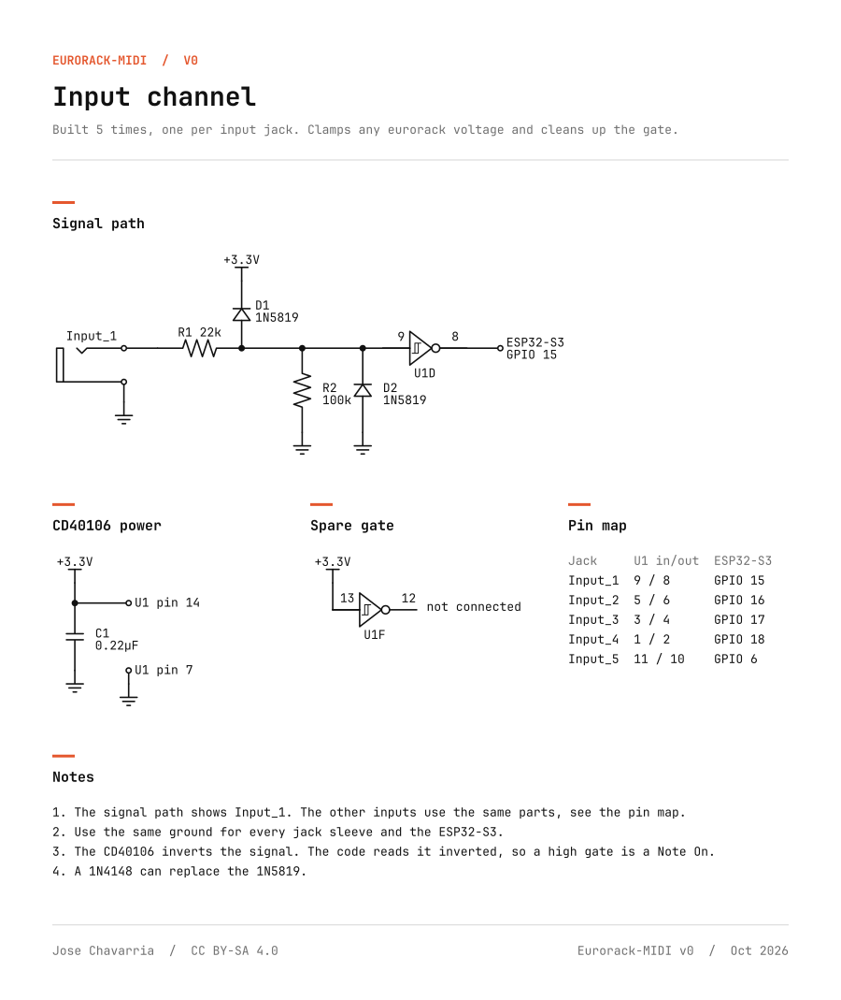
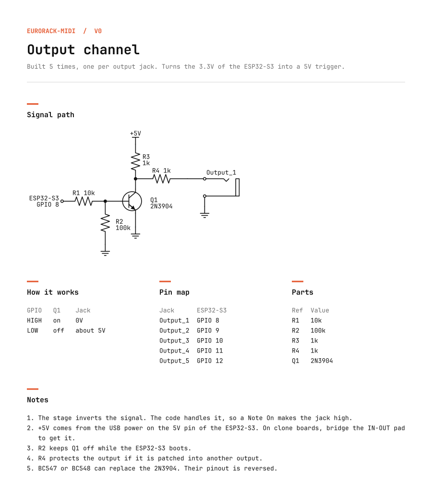
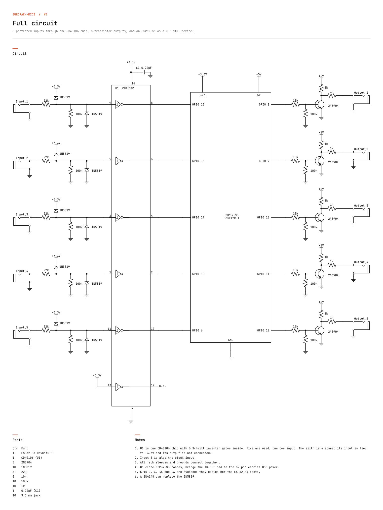

# Eurorack-MIDI

> **Version 0 (v0).** This is the first working version of the project: a hand-soldered perfboard prototype that has been built and tested. It works, but it is a starting point, not a finished product. Future versions can (and should) improve on it. See [Ideas for future versions](#ideas-for-future-versions).

A small two-way bridge between a eurorack modular synth and a computer.

An ESP32-S3 shows up on the computer as a USB MIDI device called **Eurorack-MIDI**. No drivers are needed, so it works with Ableton Live, any other DAW, Max/MSP, Pure Data, Processing, Web MIDI in the browser, and so on.

- **5 inputs (eurorack to computer):** gates and triggers from the modular become MIDI notes.
- **Clock input:** input 5 can also read a clock from the modular and send it to the computer as MIDI Clock, so the DAW follows the modular's tempo.
- **5 outputs (computer to eurorack):** MIDI notes from the computer become triggers or gates on the output jacks.

## How it works

| Direction | MIDI channel* | What happens |
|---|---|---|
| Input_1 to Input_5 | 0 (shown as **Channel 1**) | Gate high sends Note On, gate low sends Note Off |
| Input_5 (clock) | none (MIDI Clock has no channel) | Pulses become MIDI Clock, Start and Stop |
| Output_1 to Output_5 | 1 (shown as **Channel 2**) | Note On fires the jack, as a trigger or a gate |

\* MIDI channels are numbered 0 to 15 inside the messages, but most DAWs display them as 1 to 16.

Inputs and outputs use the General MIDI drum map, so they line up with drum racks and drum machines:

| Jack | Note | Sound |
|---|---|---|
| Input_1 / Output_1 | 36 | Kick |
| Input_2 / Output_2 | 38 | Snare |
| Input_3 / Output_3 | 39 | Clap |
| Input_4 / Output_4 | 42 | Closed hi-hat |
| Input_5 / Output_5 | 46 | Open hi-hat |

### Clock input

Patch a clock that pulses on every step into Input_5. By default the code expects **4 pulses per beat** (16th notes, one per step of a 16-step sequencer). For every pulse it sends 6 MIDI clock ticks, because MIDI clock runs at 24 ticks per beat, spaced according to the measured tempo.

- The first pulse sends **MIDI Start**.
- If no pulse arrives for 2 seconds, it sends **MIDI Stop**.
- In your DAW, enable external sync for the **Eurorack-MIDI** input (in Ableton Live, open *Settings* or *Preferences*, go to the *Link, Tempo & MIDI* tab and turn on **Sync** for that input).

If your clock module sends a different rate, change `clockPulsesPerBeat` in the code. It must divide 24: 1 (quarter notes), 2 (8ths), 3, 4 (16ths), 6, 8, 12 or 24.

### Outputs: trigger or gate

Each output can work in one of two modes, set in `outputModes`:

- **Trigger** (default): a 10 ms pulse on every Note On. Good for drums and envelopes.
- **Gate**: the jack stays high while the note is held.

## Hardware

### Schematics

**One input channel** (built 5 times). The protection network keeps any eurorack voltage (up to ±12V) away from the chip, and the CD40106 Schmitt trigger turns slow or noisy edges into clean ones.



**One output channel** (built 5 times). The ESP32 only outputs 3.3V, so a transistor switches a 5V pull-up to give a proper 5V trigger.



**Full circuit:**



PNG versions of all three are in [`hardware/schematics`](hardware/schematics). The diagrams are set in [JetBrains Mono](https://www.jetbrains.com/lp/mono/) (SIL Open Font License).

### Bill of materials

See [`hardware/BOM.md`](hardware/BOM.md) (also as [`BOM.csv`](hardware/BOM.csv)).

### Pin mapping

| Input | CD40106 in / out | ESP32-S3 | | Output | ESP32-S3 |
|---|---|---|---|---|---|
| Input_1 | 9 / 8 | GPIO 15 | | Output_1 | GPIO 8 |
| Input_2 | 5 / 6 | GPIO 16 | | Output_2 | GPIO 9 |
| Input_3 | 3 / 4 | GPIO 17 | | Output_3 | GPIO 10 |
| Input_4 | 1 / 2 | GPIO 18 | | Output_4 | GPIO 11 |
| Input_5 (clock) | 11 / 10 | GPIO 6 | | Output_5 | GPIO 12 |

The spare CD40106 gate has its input (pin 13) tied to +3.3V, and its output (pin 12) is left unconnected. Pin 14 goes to +3.3V and pin 7 to GND.

GPIO 0, 3, 45 and 46 are avoided on purpose: they are strapping pins that decide how the ESP32-S3 boots. GPIO 19 and 20 are used by USB.

### Build notes

- **5V pin on clone boards:** many ESP32-S3 boards sold as "DevKitC-1" (often marked N16R8) are clones with a small solder pad labelled **IN-OUT** on the front, near the USB connectors. Bridge it with solder, otherwise the 5V pin does not carry USB power and the outputs will not work. Do **not** bridge the **USB-OTG** pad.
- **Use an IC socket** for the CD40106 so it can be replaced.
- **Shared ground:** every jack sleeve must connect to the ESP32's GND.
- **Build and test one input and one output first**, then the other four.
- **Check with a multimeter** before powering up: +3.3V, +5V and GND must not be connected to each other.
- **Diodes:** the 1N4148 works in place of the 1N5819 if that is what you have.

## Software

### Arduino IDE setup

1. Install the **esp32** board package by Espressif (version 3.x) from the Boards Manager.
2. Open [`firmware/Eurorack-MIDI/Eurorack-MIDI.ino`](firmware/Eurorack-MIDI/Eurorack-MIDI.ino).
3. In the **Tools** menu, select:
   - **Board:** ESP32S3 Dev Module
   - **USB Mode:** USB-OTG (TinyUSB). Without this the sketch stops with an error, on purpose.
4. Upload. On boards with two USB ports, upload through the **UART/COM** port if the native port gives trouble, then use the port labelled **USB** for MIDI.

If an upload fails, hold **BOOT**, tap **RESET**, release BOOT and upload again.

### Settings

All settings are at the top of the sketch:

| Setting | Default | What it does |
|---|---|---|
| `inputChannel` / `outputChannel` | 0 / 1 | MIDI channels (0 to 15) |
| `inputNotes` / `outputNotes` | 36, 38, 39, 42, 46 | Note for each jack |
| `inputVelocity` | 100 | Velocity of the notes sent to the computer |
| `minNoteLength` | 10 ms | Shortest note sent, since some DAWs miss 1 ms triggers |
| `useClockInput` | true | Turns the clock on Input_5 on or off |
| `clockSendsNote` | true | Input_5 also sends its note while used as clock |
| `clockPulsesPerBeat` | 4 | Clock pulses per beat from the modular |
| `sendStartStop` | true | Sends MIDI Start and Stop with the clock |
| `printBpm` | false | Prints the measured tempo on the Serial Monitor (UART port, 115200 baud) |
| `outputModes` | all trigger | Trigger or gate for each output |
| `triggerLength` | 10 ms | Length of a trigger pulse |

### Testing

Before opening a DAW, check that messages arrive with a MIDI monitor, such as [Snoize MIDI Monitor](https://www.snoize.com/midimonitor/) on macOS, [MIDI-OX](http://www.midiox.com/) on Windows, or any Web MIDI monitor page in Chrome.

## Known limitations of v0

- **Outputs at power-up:** during the moment the ESP32 boots, before the code runs, the output jacks sit high. A patched module may fire once when you plug in the USB cable.
- **5V outputs only:** most modules are happy with 5V triggers and gates, but some expect 10V.
- **Fixed notes and velocity:** inputs always send the same note and velocity, with no pitch CV or velocity CV yet.
- **Board specific:** the layout and pin mapping assume an ESP32-S3-DevKitC-1 style board. Other ESP32-S3 boards need the pins checked.
- **Hand-tapped clocks** make the DAW tempo wobble. A steady clock from a module works best.

## Ideas for future versions

- Pitch CV input (1V/octave) to send real note numbers
- Velocity from a CV input, and CCs from knobs or CV
- 10V outputs using the eurorack power supply and an op-amp (TL072/TL074)
- MIDI clock output to the modular
- LEDs showing activity on each jack
- A proper PCB and a eurorack panel
- Fixing the output state at power-up

Contributions, forks and new versions are welcome.

## Repository structure

```
Eurorack-MIDI/
├── README.md
├── CHANGELOG.md
├── LICENSE.md
├── firmware/
│   └── Eurorack-MIDI/
│       └── Eurorack-MIDI.ino
└── hardware/
    ├── BOM.md
    ├── BOM.csv
    └── schematics/
        ├── input-channel.svg / .png
        ├── output-channel.svg / .png
        ├── full-circuit.svg / .png
        └── source/        (Python scripts and fonts that draw the schematics)
```

## Credits

Created by **Jose Chavarria**, 2026.

This project was partially developed with the help of AI (Claude, by Anthropic), then built, tested and adjusted on real hardware.

## License

This project is open source, licensed under [Creative Commons Attribution-ShareAlike 4.0 International (CC BY-SA 4.0)](https://creativecommons.org/licenses/by-sa/4.0/). See [`LICENSE.md`](LICENSE.md).
